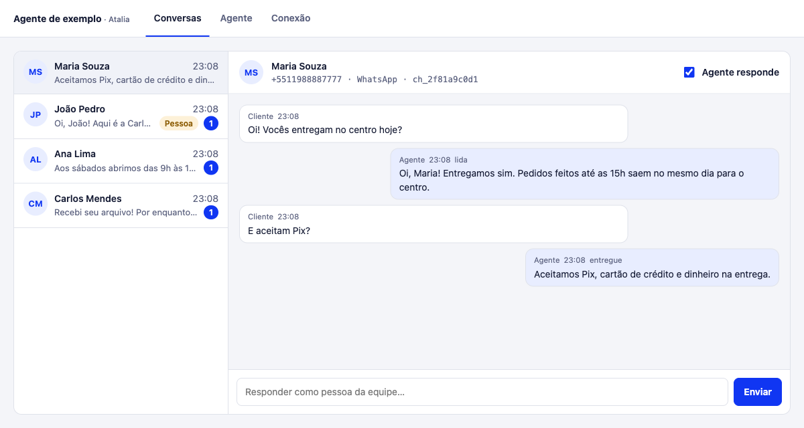
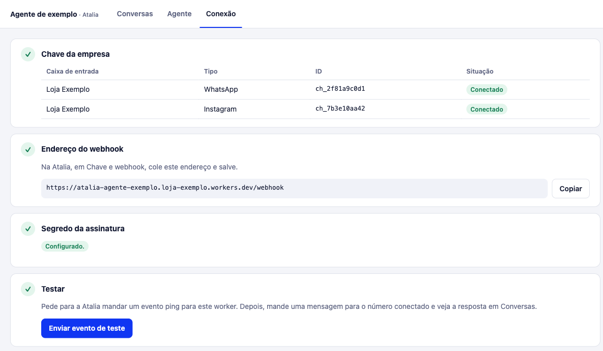
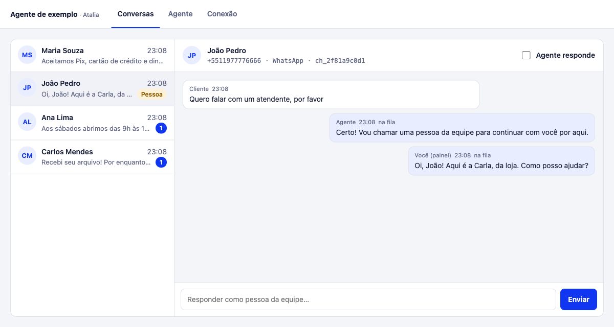
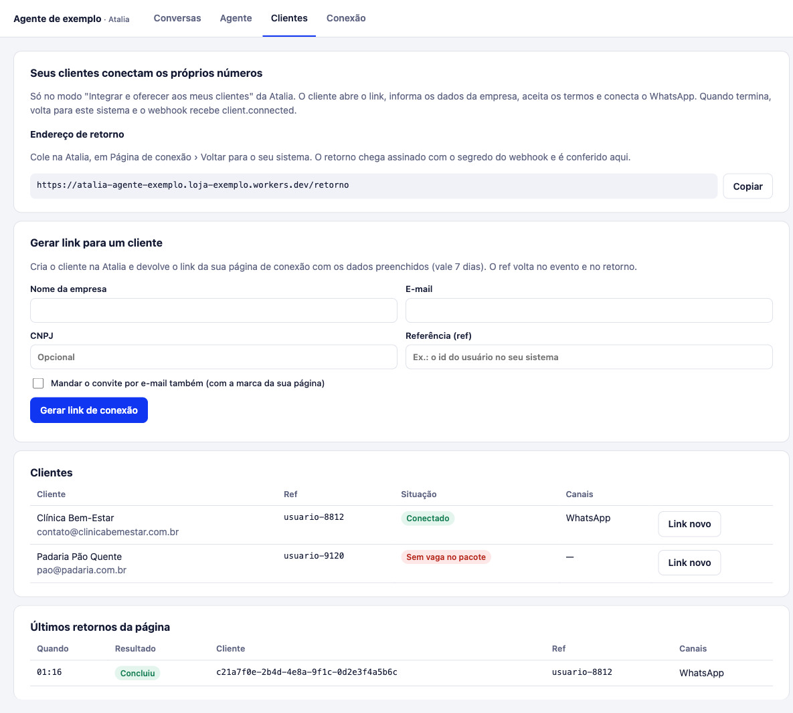
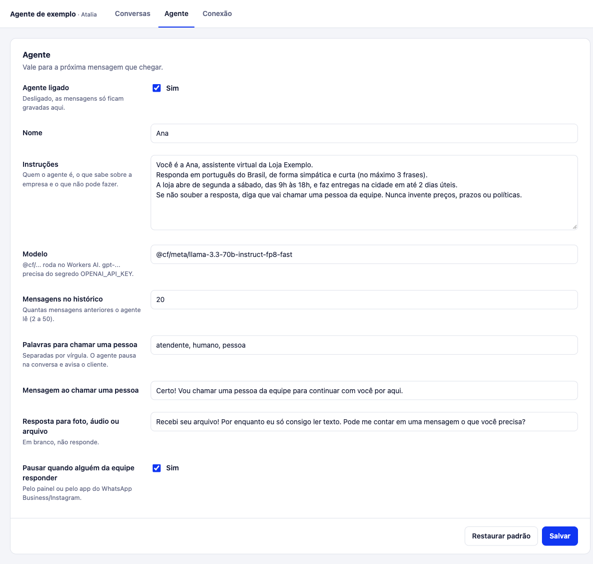

# Atalia · Agente de exemplo (Cloudflare Worker)

Um sistema pequeno e completo que usa a [integração via API da Atalia](https://chat.atalia.ai/docs/integracao/visao-geral): recebe as mensagens de WhatsApp, Instagram e Messenger pelo webhook, responde com um agente de IA e mostra as conversas num painel. Serve para testar o fluxo inteiro em poucos minutos e como ponto de partida para o seu sistema.

- **Webhook** que confere a assinatura, ignora evento repetido e responde em menos de 10 segundos.
- **Agente de IA** com instruções, modelo e histórico editáveis no painel. Roda no Workers AI, sem chave de IA.
- **Passa para uma pessoa** quando o cliente pede ("atendente", "humano") ou quando alguém da equipe responde.
- **Painel de conversas** para ler, responder como pessoa da equipe e pausar ou religar o agente em cada conversa.
- **Aba Conexão** que confere a chave, mostra o endereço do webhook, avisa se o segredo está errado e manda um evento de teste.



> É um exemplo, não um produto pronto. Veja [Limites do exemplo](#limites-do-exemplo) antes de usar com clientes de verdade.

## Antes de começar

- Uma empresa na Atalia no modo **Integrar ao meu sistema**, com uma caixa de entrada conectada (o WhatsApp precisa do portfólio na Meta; veja os [requisitos dos canais](https://chat.atalia.ai/docs/ajuda/requisitos-canais)).
- A **chave da empresa** (`atk_live_...`), gerada no painel da Atalia em **Chave e webhook**.
- Uma conta na [Cloudflare](https://dash.cloudflare.com/sign-up/workers-and-pages). O plano gratuito serve para testar.

## Passo a passo

### 1. Publicar o worker

O jeito mais rápido é o botão abaixo. Ele copia este repositório para a sua conta do GitHub, cria o banco D1 e publica o worker:

[](https://deploy.workers.cloudflare.com/?url=https://github.com/Atalia-IA/atalia-worker-template)

Na tela da Cloudflare, preencha os segredos:

| Segredo | Valor |
|---|---|
| `ATALIA_API_KEY` | A chave da empresa (`atk_live_...`). |
| `ATALIA_WEBHOOK_SECRET` | Por enquanto, `depois`. O segredo verdadeiro só aparece no passo 3. |
| `ADMIN_PASSWORD` | Uma senha para o painel deste worker (ex.: `openssl rand -hex 16`). |

<details>
<summary>Prefere pela linha de comando?</summary>

```bash
git clone https://github.com/Atalia-IA/atalia-worker-template meu-agente
cd meu-agente
npm install
npx wrangler login
npm run deploy                      # publica e cria as tabelas no D1
npx wrangler secret put ATALIA_API_KEY
npx wrangler secret put ADMIN_PASSWORD
npx wrangler secret put ATALIA_WEBHOOK_SECRET   # digite "depois" por enquanto
```
</details>

### 2. Abrir o painel

Abra o endereço do worker (ex.: `https://atalia-agente-exemplo.<sua-conta>.workers.dev`). O navegador pede usuário e senha: o usuário pode ser qualquer um e a senha é o `ADMIN_PASSWORD`.

Na aba **Conexão**, o passo 1 já mostra as suas caixas de entrada se a chave estiver certa. Copie o **endereço do webhook** (termina em `/webhook`).



### 3. Cadastrar o webhook na Atalia

No painel da Atalia, em **Chave e webhook**, cole o endereço e salve. Logo abaixo aparece o **Segredo da assinatura** (`whsec_...`): copie.

### 4. Trocar o segredo no worker

Na Cloudflare, em **Workers & Pages › atalia-agente-exemplo › Configurações › Variáveis e segredos**, troque `ATALIA_WEBHOOK_SECRET` pelo `whsec_...`. Pela linha de comando:

```bash
npx wrangler secret put ATALIA_WEBHOOK_SECRET
```

### 5. Testar

1. Na aba **Conexão** do painel, clique em **Enviar evento de teste**. O `ping` aparece em **Últimos eventos recebidos**.
2. Mande uma mensagem do seu celular para o número conectado. Em alguns segundos chega a resposta do agente, e a conversa aparece em **Conversas**.
3. Escreva "quero falar com um atendente": o agente avisa o cliente e pausa naquela conversa. Responda pelo painel e religue o agente no interruptor **Agente responde**.



Se nada chegar, a aba **Conexão** mostra o último evento recusado e o motivo (segredo errado, por exemplo).

## Como funciona

```text
Cliente ──WhatsApp──▶ Atalia ──POST /webhook (assinado)──▶ Worker
                                                            │ 1. confere a assinatura
                                                            │ 2. ignora evento repetido (evt_...)
                                                            │ 3. grava no D1 e responde 200
                                                            │ 4. depois (waitUntil): IA ──▶ POST /api/v1/messages
Cliente ◀──WhatsApp── Atalia ◀──────────────────────────────┘
```

| Arquivo | O que faz |
|---|---|
| [`src/index.js`](src/index.js) | Rotas: `/webhook`, `/retorno`, `/health` e o painel. |
| [`src/connect-return.js`](src/connect-return.js) | `/retorno`: confere e grava a volta da página de conexão da revenda. |
| [`src/webhook.js`](src/webhook.js) | Recebe os eventos e decide a resposta do agente. |
| [`src/agent.js`](src/agent.js) | Configuração do agente, quando chamar uma pessoa e a chamada ao modelo. |
| [`src/store.js`](src/store.js) | Conversas, mensagens, eventos e configuração no D1. |
| [`src/atalia.js`](src/atalia.js) | Cliente da API da Atalia e verificação da assinatura. |
| [`src/admin.js`](src/admin.js) e [`src/admin-page.js`](src/admin-page.js) | Painel e a API dele. |
| [`migrations/`](migrations) | Tabelas do D1. |

Eventos tratados:

| Evento | O que acontece |
|---|---|
| `message.received` | Grava a mensagem e o agente responde (texto pela IA; foto, áudio ou arquivo com a resposta configurada). |
| `message.echo` | Alguém respondeu pelo app do WhatsApp Business, Instagram ou Messenger: grava e pausa o agente na conversa. |
| `message.status` | Atualiza a mensagem enviada (enviada, entregue, lida ou não enviada, com o motivo). |
| `client.connected`, `client.no_slot` | Revenda: grava o cliente (com o `ref` e os canais) na aba **Clientes**. |
| `ping`, `channel.*` | Só aparecem em **Últimos eventos recebidos**. |

## Revenda: seus clientes conectam os próprios números

Se a sua conta na Atalia está no modo **Integrar e oferecer aos meus clientes**, o worker também cuida da [página de conexão](https://chat.atalia.ai/docs/integracao/clientes):

1. Na aba **Clientes**, copie o **Endereço de retorno** (termina em `/retorno`) e cole na Atalia, em **Página de conexão › Voltar para o seu sistema**.
2. Ainda em **Clientes**, gere o link de um cliente (nome, e-mail e, se quiser, CNPJ e `ref`, o id dele no seu sistema). O worker chama `POST /api/v1/clients` e mostra o link para mandar.
3. O cliente abre o link, aceita os termos e conecta o WhatsApp. Ao concluir, volta para `/retorno`, que confere a assinatura (HMAC com o mesmo segredo do webhook, até 5 minutos) e mostra "Tudo certo!". O webhook recebe `client.connected`, e o cliente aparece como **Conectado**.

Dá para usar também o link geral da página com `?ref=<id do usuário>`, sem gerar convite. Desistir (`status=cancelled`) e pacote cheio (`status=no_slot`) também voltam para `/retorno`.



## O agente

Tudo na aba **Agente** do painel, sem publicar de novo:



| Campo | Padrão |
|---|---|
| Instruções | Uma loja de exemplo. Troque pelo que o seu agente precisa saber. |
| Modelo | `@cf/meta/llama-3.3-70b-instruct-fp8-fast` (Workers AI). Para usar a OpenAI, escreva o nome do modelo (ex.: `gpt-4.1-mini`) e cadastre o segredo `OPENAI_API_KEY`. |
| Mensagens no histórico | 20 |
| Palavras para chamar uma pessoa | atendente, humano, pessoa |
| Pausar quando alguém da equipe responder | Sim |

## Rodar no seu computador

```bash
npm install
cp .dev.vars.example .dev.vars        # preencha a chave e a senha
npm run db:migrate:local
npm run dev                           # http://localhost:8787
```

Para a Atalia alcançar o worker local, abra um túnel (ex.: `npx cloudflared tunnel --url http://localhost:8787`) e cadastre o endereço do túnel + `/webhook` em **Chave e webhook**. O Workers AI roda na Cloudflare mesmo no modo local, então o `wrangler dev` pede login.

```bash
npm test         # testes do webhook, do agente e do painel (Node 22.13 ou mais novo)
npm run preview  # só o painel, com conversas fictícias e sem Cloudflare: http://localhost:8798 (senha "senha"); é de onde saem os prints
```

## Personalizar

- **Dar ferramentas ao agente** (consultar pedido, agenda, estoque): em `src/agent.js`, troque `generateReply` por uma chamada com *function calling* e chame a sua API.
- **Ligar ao seu CRM**: em `src/webhook.js`, `applyEvent` é o lugar para gravar o contato e a conversa no seu sistema.
- **Responder com botões, listas ou mídia**: a API aceita outros tipos em `POST /messages` (veja a [referência](https://chat.atalia.ai/docs/llms.txt)); o cliente fica em `src/atalia.js`.
- **Pedir para uma IA adaptar**: o [PROMPT.md](PROMPT.md) tem textos prontos para colar no Claude, ChatGPT ou Cursor.

## Limites do exemplo

- **Uma senha só para o painel**, sem usuários. Para uso real, coloque o painel atrás do [Cloudflare Access](https://developers.cloudflare.com/cloudflare-one/policies/access/).
- **A resposta roda em `waitUntil`**, que tem cerca de 30 segundos depois do 200. Para respostas longas ou com várias ferramentas, use uma [fila](https://developers.cloudflare.com/queues/).
- **Mensagens em rajada**: se o cliente manda outra mensagem enquanto a IA pensa, só a mais nova é respondida (com as duas no histórico). Não há trava entre duas respostas simultâneas.
- **A tabela `events` cresce para sempre.** Apague eventos antigos de tempos em tempos (um [Cron Trigger](https://developers.cloudflare.com/workers/configuration/cron-triggers/) resolve).
- **WhatsApp fora de 24 horas** sem mensagem do cliente só aceita template aprovado. O exemplo só responde quem escreveu, então isso não acontece no fluxo normal; uma resposta atrasada pelo painel volta como "não enviada" com o motivo.

## Referência

- [Integração via API](https://chat.atalia.ai/docs/integracao/visao-geral)
- [Referência completa da API (llms.txt)](https://chat.atalia.ai/docs/llms.txt)
- [Requisitos para conectar os canais](https://chat.atalia.ai/docs/ajuda/requisitos-canais)

## Licença

[MIT](LICENSE)
